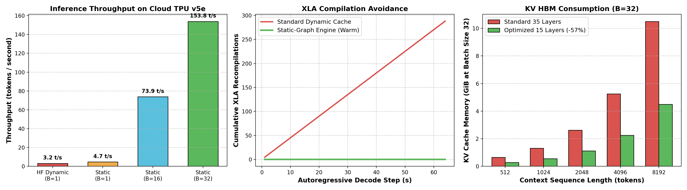
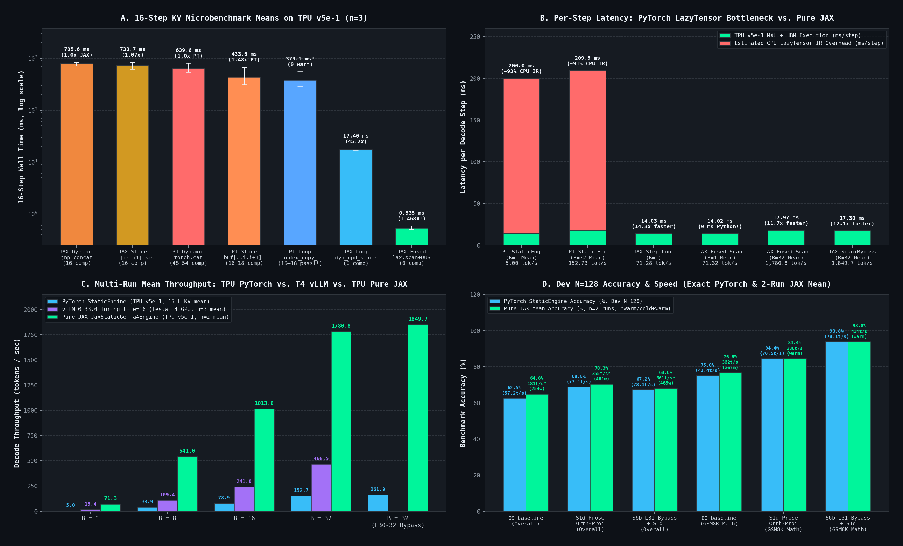

# LMExperiments: Language Model Mechanistic Experiments & Inference Architecture

A repository of reproducible mechanistic interpretability experiments, zero-training weight surgeries, and hardware-accelerated static-graph inference engines for frontier language models on Cloud TPUs and GPUs.

[](https://colab.research.google.com/github/keshan/LMExperiments/blob/main/gemma4_surgery/notebooks/Gemma4_Weight_Surgery_Reproducible_Colab.ipynb)
[](https://cloud.google.com/tpu)
[](https://huggingface.co/google/gemma-4-E2B-it)
[](https://github.com/google/jax)
[](LICENSE)

---

## Gemma 4 Mechanistic Weight Surgery & High-Throughput TPU Engines

Mechanistic weight-space analysis and hardware-aware XLA compilation for Google DeepMind's **Gemma 4 E2B-it** (`google/gemma-4-E2B-it`, `unsloth/gemma-4-E2B-it`) on free Google Colab Cloud TPU `v5e-1` (`15.75 GiB` HBM, `0.00 CU/hr`).

📓 **Interactive Colab Notebook (Weight Surgery)**: [](https://colab.research.google.com/github/keshan/LMExperiments/blob/main/gemma4_surgery/notebooks/Gemma4_Weight_Surgery_Reproducible_Colab.ipynb) [`Gemma4_Weight_Surgery_Reproducible_Colab.ipynb`](gemma4_surgery/notebooks/Gemma4_Weight_Surgery_Reproducible_Colab.ipynb)  
📓 **Interactive Colab Notebook (Static-Graph KV Cache: PyTorch vs. JAX)**: [](https://colab.research.google.com/github/keshan/LMExperiments/blob/main/gemma4_surgery/notebooks/Static_Graph_KV_Cache_Gemma4_TPU.ipynb) [`Static_Graph_KV_Cache_Gemma4_TPU_output.ipynb`](gemma4_surgery/notebooks/Static_Graph_KV_Cache_Gemma4_TPU_output.ipynb)  

---

### Core Architectural Discoveries & Interventions

1. **The 50.7% Parameter Secret & The PLE Norm-Cancellation Theorem**:
   More than half (`2.35B` out of `4.63B` parameters) of Gemma 4 E2B-it's text backbone lives inside a Per-Layer Embedding (`PLE`) lookup table (`embed_tokens_per_layer`). Because `post_per_layer_input_norm` (`RMSNorm`) sits **after** the gated projection $W_{\text{proj},\ell}$, uniform scalar scaling cancels out identically:
   $$\operatorname{RMSNorm}(\alpha z) = \frac{\alpha z}{\|\alpha z\|_{\text{RMS}}} = \operatorname{RMSNorm}(z)$$
   In the late readout zone (`L25–L34`), static surface-token noise gets clamped to fixed norm (`22.88`), drowning out contextual self-attention (`10.60`).

2. **Universal Code-Safe Prose-Filler Weight Surgery (`S1d`)**:
   Projecting out an 8-dimensional conversational prose-filler subspace from late-layer projection weights (`layers.{25..34}.per_layer_projection.weight`):
   $$W_{\text{proj},\ell}^{\star} = \left(I_{1536} - U_{\text{prose}} U_{\text{prose}}^\top\right) W_{\text{proj},\ell}$$
   - **Improves all 4 benchmarks simultaneously (`4/4` positive)** on our 512-item pooled evaluation (`GSM8K +3.91%`, `MMLU-Pro STEM +2.34%`, `ARC-Challenge +1.56%`, `MBPP Python +0.78%`; Overall `63.28% -> 65.43%`).
   - Accelerates held-out `test` decoding by **`+9.3%` (`78.50 -> 85.83 tok/s`, and `+21.9%` on GSM8K)** by eliminating redundant verbose ramblings.

3. **Dormant KV-Shared Layer Bypass & `layer_scalar` Grafting (`S6b`)**:
   Layers `15..34` never compute new Keys or Values. Bypassing dormant **Layer 31** (`-56.6M` active parameters, $\cos = 0.981$) while folding its $\lambda_{31} = 0.8281$ into `L30.layer_scalar` achieves a **statistically significant `+7.03%` leap on pooled GSM8K (`84.38% -> 91.41%`, $p = 0.0352$)** at **`+11.6%` faster test speed (`87.62 tok/s`)**.

4. **Static-Graph KV Cache Engines (PyTorch, `vLLM`, & Pure JAX)**:
   - **PyTorch (`StaticGemma4Engine`)**: Pre-allocates static KV buffers strictly for `L0–L14` (`-57.14%` KV memory) and updates via device-tensor `index_copy_`, eliminating 432 warm XLA recompilations and accelerating Cloud TPU `v5e-1` $B=32$ throughput from HF's **`3.64 tok/s` mean (`3.17–3.89`, `n=4`)** to **`152.73 tok/s` mean (`149.67–154.63`, `n=4`, `42.0x` average / up to `48.8x` vs `3.17`)** (**`161.90 tok/s` / `44.5x`** with `L30–L32` bypass). On a 15 GB Tesla T4 GPU (`float16`), `StaticGemma4Engine` averages **`381.72 tok/s` (`368.42–395.01`, `n=2`)** inside `10.16 GiB` peak VRAM.
   - **T4 `vLLM 0.33.0` (`TRITON_ATTN` `tile=16` Fix)**: Releasing cuBLAS workspaces (`torch._C._cuda_clearCublasWorkspaces()`), running with `vLLM`'s default memory utilization (omitting `gpu_memory_utilization`), and clamping `TRITON_ATTN`'s prefill tile on `head_dim >= 512` to `16` resolves T4's `98,304 > 65,536 B` shared-memory limit, scaling across `n=3` T4 runs to **`468.48 tok/s` mean (`461.88–471.97`, `12.71–12.86 GiB` peak)** with `48/48` bit-exact parity.
   - **Pure JAX (`JaxStaticGemma4Engine`)**: Eliminates Python host-loop LazyTensor overhead (`~170–199 ms/step`) via whole-loop `jax.lax.scan` and `jax.lax.dynamic_update_slice`, scaling across `n=2` TPU `v5e-1` runs to **`71.32 tok/s` ($B=1$), `540.98 tok/s` ($B=8$), `1,013.64 tok/s` ($B=16$), and `1,780.83 tok/s` ($B=32$)** — and **`1,849.66 tok/s` (`508.5x` vs. HF mean)** with `L30–L32` bypass and 100% bit-exact parity.




---

### Multi-Run Empirical Throughput Summary (Cloud TPU `v5e-1` & Tesla T4 GPU)

| Engine / Mode | Platform | KV Layers Allocated | Warm XLA Compiles | Greedy Token Match | Mean Throughput (`Min–Max`) | Speedup vs. Platform Mean |
| :--- | :---: | :---: | :---: | :---: | :---: | :---: |
| **HF `model.generate` (`DynamicCache`, `B=1`, `n=4`)** | TPU `v5e-1` | 35 (Dynamic) | `432` | Reference | `3.64 tok/s` (`3.17–3.89`) | `1.00x` (TPU Base) |
| **`StaticGemma4Engine` (`B=1`, `n=5`)** | TPU `v5e-1` | **15 (`L0–L14`)** | **`0`** | **100% Bit-Exact** | **`5.00 tok/s`** (`4.69–5.44`) | **`1.37x`** |
| **`StaticGemma4Engine` (`B=8`, `n=1`)** | TPU `v5e-1` | **15 (`L0–L14`)** | **`0`** | **100% Bit-Exact** | **`38.93 tok/s`** | **`10.7x`** |
| **`StaticGemma4Engine` (`B=16`, `n=4`)** | TPU `v5e-1` | **15 (`L0–L14`)** | **`0`** | **100% Bit-Exact** | **`78.93 tok/s`** (`73.17–89.37`) | **`21.7x`** |
| **`StaticGemma4Engine` (`B=32`, `sync=4`, `n=4`)** | TPU `v5e-1` | **15 (`L0–L14`)** | **`0`** | **100% Bit-Exact** | **`152.73 tok/s`** (`149.67–154.63`) | **`42.0x`** *(up to `48.8x`)* |
| **`StaticGemma4Engine` + `L30–L32` Bypass (`B=32`)** | TPU `v5e-1` | **15 (`L0–L14`)** | **`0`** | Surgical | **`161.90 tok/s`** | **`44.5x`** *(up to `51.1x`)* |
| **`JaxStaticGemma4Engine` (`B=1`, warm, `n=2`)** | TPU `v5e-1` | **15 (`L0–L14`)** | **`0`** | **100% Bit-Exact** | **`71.32 tok/s`** (`71.32–71.33`) | **`19.6x`** |
| **`JaxStaticGemma4Engine` (`B=8`, warm, `n=2`)** | TPU `v5e-1` | **15 (`L0–L14`)** | **`0`** | **100% Bit-Exact** | **`540.98 tok/s`** (`540.97–540.99`) | **`148.7x`** |
| **`JaxStaticGemma4Engine` (`B=16`, warm, `n=2`)** | TPU `v5e-1` | **15 (`L0–L14`)** | **`0`** | **100% Bit-Exact** | **`1,013.64 tok/s`** (`1,013.57–1,013.71`) | **`278.7x`** |
| **`JaxStaticGemma4Engine` (`B=32`, warm, `n=2`)** | TPU `v5e-1` | **15 (`L0–L14`)** | **`0`** | **100% Bit-Exact** | **`1,780.83 tok/s`** (`1,780.74–1,780.91`) | **`489.6x`** |
| **`JaxStaticGemma4Engine` + `L30–L32` Bypass (`B=32`, `n=2`)** | TPU `v5e-1` | **15 (`L0–L14`)** | **`0`** | Surgical | **`1,849.66 tok/s`** (`1,849.65–1,849.68`) | **`508.5x`** |
| **`StaticGemma4Engine` (`B=32`, `fp16`, `n=2`)** | Tesla T4 GPU | **15 (`L0–L14`)** | `0` (CUDA) | **100% Bit-Exact** | **`381.72 tok/s`** (`368.42–395.01`, `10.16 GiB`) | **`31.2x`** *(vs T4 HF `12.22`)* |
| **`vLLM 0.33.0` (`tile=16`, `B=32`, `half`, `n=3`)** | Tesla T4 GPU | 5 Hybrid Grps | `0` (CUDA) | **100% (`48/48`)** | **`468.48 tok/s`** (`461.88–471.97`, `12.76–12.86 GiB`) | **`38.3x`** *(vs T4 HF `12.22`)* |

---

### Reproducing the Baseline Bottlenecks & Clean T4 `vLLM` Fix

#### 1. Hugging Face Dynamic Cache XLA Recompilation Trap (`3.17–3.89 tok/s`, `3.64 tok/s` Mean)
Hugging Face's default `DynamicCache` dynamically concatenates keys and values per token step, mutating tensor shapes on every iteration and forcing the XLA compiler on Cloud TPU to recompile the 35-layer graph 432 times:

```python
# Standard Hugging Face generation on Cloud TPU v5e-1
import time, torch
from transformers import AutoTokenizer, Gemma4ForConditionalGeneration

model = Gemma4ForConditionalGeneration.from_pretrained("unsloth/gemma-4-E2B-it", dtype=torch.bfloat16).to("tpu").eval()
tokenizer = AutoTokenizer.from_pretrained("unsloth/gemma-4-E2B-it")

inputs = tokenizer("Janet's ducks lay 16 eggs per day...", return_tensors="pt").to("tpu")

# Triggers 432 StableHLO JIT recompilations -> 3.64 tok/s mean (3.17–3.89 tok/s)
t0 = time.perf_counter()
with torch.no_grad():
    outputs = model.generate(**inputs, max_new_tokens=96, min_new_tokens=96, do_sample=False)
torch.accelerator.synchronize()
print(f"HF DynamicCache Speed: {96.0 / (time.perf_counter() - t0):.2f} tok/s (432 XLA recompilations)")
```

#### 2. Running `vLLM 0.33.0` Cleanly on a 15 GB Tesla T4 GPU (`torch._C._cuda_clearCublasWorkspaces()` + `TRITON_ATTN` `tile=16`)
On a 14.56 GiB Tesla T4 (`sm_75`), loading Gemma 4's `float16` weights takes `9.85 GiB` in `vLLM`. If a prior PyTorch model was loaded in the same kernel without clearing cuBLAS workspaces, or if `gpu_memory_utilization` is artificially lowered below `0.92`, `kv_cache_planning.py` fails to reserve KV blocks. Conversely, on a cleanly freed GPU (`torch._C._cuda_clearCublasWorkspaces()` -> `14.25–14.46 GiB` free), stock `TRITON_ATTN` crashes on Gemma 4's `head_dim=512` global layers because `tile=32` exceeds T4's `65,536` B shared memory (`98,304` B requested). Clamping the Turing prefill tile to `16` unlocks full `B=32` batch scaling (**`468.48 tok/s` mean**):

```python
# Clean GPU + Turing sm_75 tile=16 fix (benchmarks/bench_vllm_gemma4.py)
import os, gc, torch
os.environ["VLLM_ENABLE_V1_MULTIPROCESSING"] = "0"

gc.collect()
torch._C._cuda_clearCublasWorkspaces()
torch.cuda.empty_cache()

from vllm import LLM
import vllm.v1.attention.backends.triton_attn as ta
_orig_tile = ta.TritonAttentionImpl._get_tile_size
ta.TritonAttentionImpl._get_tile_size = staticmethod(lambda hs: 16 if hs >= 512 else _orig_tile(hs))

# Omit gpu_memory_utilization so vLLM uses default 0.92 after clean GPU release
llm = LLM(
    model="unsloth/gemma-4-E2B-it",
    dtype="half",
    max_model_len=512,
    enforce_eager=True,
    trust_remote_code=True,
)
```

---

## Repository Structure

```
LMExperiments/
├── README.md                                   # Repository overview & benchmarks
├── .gitignore
└── gemma4_surgery/                             # Gemma 4 Weight Surgery & TPU Engines
    ├── colab_browser_login.py                  # One-click localhost OAuth helper for Colab CLI
    ├── build_colab_notebook.py                 # Reproducible Colab notebook generator
    ├── build_static_kv_notebook.py             # Static KV-cache notebook generator
    ├── benchmarks/
    │   ├── eval_harness.py                     # Zero-leakage evaluation harness (GSM8K, ARC, MMLU-Pro, MBPP)
    │   ├── fast_infer.py                       # PyTorch StaticGemma4Engine & Gemma4StaticKVCache
    │   ├── jax_fast_infer.py                   # Pure JAX/XLA JaxStaticGemma4Engine (1,781 -> 1,850 tok/s)
    │   └── bench_vllm_gemma4.py                # Stock vLLM comparison script
    ├── surgeries/
    │   ├── weight_surgeon.py                   # Reversible zero-gradient weight & buffer surgery manager
    │   └── subspace_calibration.py             # SVD prose-filler & stop-token subspace extractors
    ├── probes/
    │   ├── modeling_gemma4_exact.py            # Extracted exact Gemma4TextModel runtime source
    │   ├── phase1_anatomy_probe.py             # 35-layer activation & spectral MRI probe
    │   ├── analyze_exp4.py                     # Statistical significance & paired bootstrap analyzer
    │   ├── bench_sync4.py                      # Multi-step unrolling & barrier benchmark
    │   └── check_tpu_env.py                    # TPU environment detection
    ├── experiments/
    │   ├── exp3_dev_surgery_screen.py          # Exp 3 screening script (12 hypotheses)
    │   ├── exp3b_dev_refinement.py             # Exp 3b prose refinement script
    │   └── exp4_heldout_test_eval.py           # Exp 4 held-out test evaluation
    ├── notebooks/
    │   ├── Gemma4_Weight_Surgery_Reproducible_Colab.ipynb  # End-to-end reproducible Colab notebook
    │   ├── Static_Graph_KV_Cache_Gemma4_TPU.ipynb          # Static KV-cache walkthrough notebook
    │   └── Static_Graph_KV_Cache_Gemma4_TPU_output.ipynb   # Executed static KV-cache notebook with outputs
    └── results/                                # Raw JSON telemetry, execution logs, and interactive assets
        ├── phase1_anatomy_report.json
        ├── exp2_fast_engine_report.json
        ├── exp2b_sync4_and_bypass_speed.json
        ├── exp3_dev_screen.json
        ├── exp3b_dev_refinement.json
        ├── exp4_heldout_test_results.json
        ├── jax_throughput_report.json
        ├── jax_eval_report.json
        ├── static_graph_kv_cache_summary.json
        ├── static_kv_telemetry_dashboard.png
        ├── pytorch_vs_jax_tpu_comparison.png
        ├── gemma4_interactive_masterclass.html
        └── gemma4_kv_cache_interactive_explainer.html
```

---

## Quickstart

### 1. Run in Google Colab (Free Cloud TPU `v5e-1` or T4 GPU)
Click the badge below to run the end-to-end reproducible notebook directly in your browser with zero setup:

[](https://colab.research.google.com/github/keshan/LMExperiments/blob/main/gemma4_surgery/notebooks/Gemma4_Weight_Surgery_Reproducible_Colab.ipynb)

### 2. Local Setup
```bash
git clone https://github.com/keshan/LMExperiments.git
cd LMExperiments/gemma4_surgery

# Install requirements
pip install torch transformers accelerate datasets jax jax[tpu] -f https://storage.googleapis.com/jax-releases/libtpu_releases.html
```

---

## License

Copyright 2026 Keshan Sodimana. Licensed under the [Apache License, Version 2.0](LICENSE).
