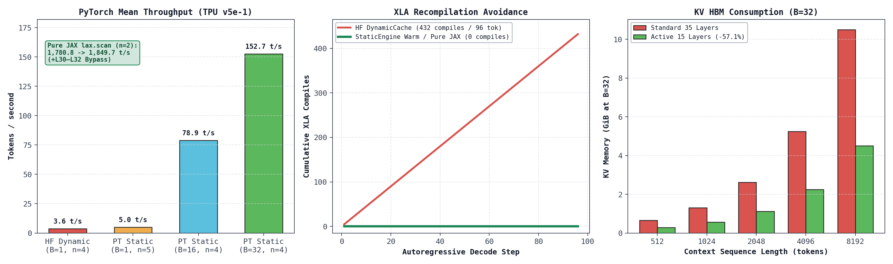

# Gemma 4 Mechanistic Weight Surgery & Novel Zero-Training Interventions

All experimental code, probes, weight-surgery modules, Colab notebooks, and benchmark logs for our **Gemma 4 E2B-it** (`unsloth/gemma-4-E2B-it`, `arXiv:2607.02770`) study live in this directory.

> [!TIP]
> 📖 **Read the full research blog post**: [**BLOG_POST.md**](BLOG_POST.md)  
> 📓 **Run in Google Colab**:  [Gemma4_Weight_Surgery_Reproducible_Colab.ipynb](notebooks/Gemma4_Weight_Surgery_Reproducible_Colab.ipynb)  
> 📓 **Static KV-Cache Notebook**:  [Static_Graph_KV_Cache_Gemma4_TPU_output.ipynb](notebooks/Static_Graph_KV_Cache_Gemma4_TPU_output.ipynb)  
> 📊 **Telemetry Dashboard**: 

## Directory Layout
- [`BLOG_POST.md`](BLOG_POST.md) — Comprehensive publication-grade research post with intuition, mathematical proofs, architecture diagrams, benchmark tables, and qualitative traces.
- [`RESEARCH_JOURNAL.md`](RESEARCH_JOURNAL.md) — Detailed experimental decision log and discovery trajectory across Exp 0 through Exp 4.
- [`probes/`](probes/) — Spectral & activation MRI probe executed on Google Colab (`v5e-1` TPU / `T4` GPU) to inspect `Gemma4TextModel` / `Gemma4TextDecoderLayer` internals (`Per-Layer Embeddings`, `post_per_layer_input_norm` norm-clamping, `num_kv_shared_layers=20` boundary, and `layer_scalar` schedules), plus [`modeling_gemma4_exact.py`](probes/modeling_gemma4_exact.py) and statistical analyzers.
- [`surgeries/`](surgeries/) — Pure training-free weight-surgery transformations ([`weight_surgeon.py`](surgeries/weight_surgeon.py)) and zero-gradient subspace projectors ([`subspace_calibration.py`](surgeries/subspace_calibration.py)).
- [`benchmarks/`](benchmarks/) — Deterministic paired evaluation harness ([`eval_harness.py`](benchmarks/eval_harness.py): GSM8K, ARC-Challenge, MMLU-Pro STEM, MBPP Sanitized, exact McNemar test + 2,000-sample bootstrap CI) and static-graph inference engines ([`fast_infer.py`](benchmarks/fast_infer.py), [`bench_vllm_gemma4.py`](benchmarks/bench_vllm_gemma4.py)).
- [`experiments/`](experiments/) — Reproducible experiment scripts ([`exp3_dev_surgery_screen.py`](experiments/exp3_dev_surgery_screen.py), [`exp3b_dev_refinement.py`](experiments/exp3b_dev_refinement.py), and modular checkpointed [`exp4_heldout_test_eval.py`](experiments/exp4_heldout_test_eval.py)).
- [`notebooks/`](notebooks/) — Self-contained reproducible Colab notebooks ([`Gemma4_Weight_Surgery_Reproducible_Colab.ipynb`](notebooks/Gemma4_Weight_Surgery_Reproducible_Colab.ipynb), [`Static_Graph_KV_Cache_Gemma4_TPU.ipynb`](notebooks/Static_Graph_KV_Cache_Gemma4_TPU.ipynb), and executed [`Static_Graph_KV_Cache_Gemma4_TPU_output.ipynb`](notebooks/Static_Graph_KV_Cache_Gemma4_TPU_output.ipynb)).
- [`results/`](results/) — Raw empirical telemetry ([`phase1_anatomy_report.json`](results/phase1_anatomy_report.json)), engine benchmarks ([`exp2_fast_engine_report.json`](results/exp2_fast_engine_report.json), [`exp2b_sync4_and_bypass_speed.json`](results/exp2b_sync4_and_bypass_speed.json), [`static_graph_kv_cache_summary.json`](results/static_graph_kv_cache_summary.json)), `dev` surgery screens ([`exp3_dev_screen.json`](results/exp3_dev_screen.json), [`exp3b_dev_refinement.json`](results/exp3b_dev_refinement.json)), held-out `test` evaluation ([`exp4_heldout_test_results.json`](results/exp4_heldout_test_results.json), [`colab_exp4_session_log.ipynb`](results/colab_exp4_session_log.ipynb)), vLLM logs ([`vllm_direct_run.log`](results/vllm_direct_run.log)), telemetry charts ([`static_kv_telemetry_dashboard.png`](results/static_kv_telemetry_dashboard.png)), and interactive visual explainer ([`gemma4_kv_cache_interactive_explainer.html`](results/gemma4_kv_cache_interactive_explainer.html)).

## Key Discoveries & Results

### 1. Static-Graph KV Cache Engines (PyTorch, `vLLM`, & Pure JAX)
- **57.14% KV Memory Savings**: Allocates KV cache strictly for the 15 KV-computing layers (`L0..L14`), eliminating 20 redundant KV-shared allocations (`L15..L34`).
- **PyTorch `StaticGemma4Engine` on Cloud TPU `v5e-1`**: Using `buf.index_copy_(2, pos_tensor, ...)` maintains static StableHLO graph shapes across decode steps, eliminating 432 warm JIT recompilations and accelerating batch-32 throughput from HF's **`3.64 tok/s` mean (`3.17–3.89`, `n=4`)** to **`152.73 tok/s` mean (`149.67–154.63`, `n=4`, `42.0x` average / up to `48.8x` vs `3.17`)** (**`161.90 tok/s` / `44.5x`** when paired with `L30–L32` bypass) while preserving **100% bit-exact greedy equivalence**.
- **Pure JAX `JaxStaticGemma4Engine` on Cloud TPU `v5e-1`**: Eliminating host-CPU LazyTensor graph tracing/hashing via stacked `jax.lax.scan` superblocks and `jax.lax.dynamic_update_slice` reaches **`71.32 tok/s` ($B=1$), `540.98 tok/s` ($B=8$), `1,013.64 tok/s` ($B=16$), and `1,780.83 tok/s` ($B=32$, `489.6x` vs HF mean)** — and **`1,849.66 tok/s` (`508.5x`)** with `L30–L32` bypass (`n=2` runs, 100% bit-exact).
- **`vLLM 0.33.0` & T4 GPU Comparison**: On Tesla T4 (`sm_75`, 14.56 GiB VRAM) after releasing PyTorch cuBLAS workspaces (`torch._C._cuda_clearCublasWorkspaces()`), stock `vLLM 0.33.0` hits T4's 64 KB shared-memory limit in `TRITON_ATTN` on Gemma 4's `head_dim=512` global layers (`98,304 > 65,536 B`), which resolves cleanly via a `_get_tile_size(head_size>=512) -> 16` Turing clamp with default memory utilization (`0.92`, omitting `gpu_memory_utilization`): across `n=3` runs, `vLLM` averages **`15.40` ($B=1$) $\to$ `240.96` ($B=16$) $\to$ `468.48 tok/s` ($B=32$, `461.88–471.97`, `12.71–12.86 GiB` peak)** with `48/48` bit-exact parity. Across `n=2` native `float16` T4 runs, `StaticGemma4Engine` averages **`13.75` ($B=1$) $\to$ `200.33` ($B=16$) $\to$ `381.72 tok/s` ($B=32$, `368.42–395.01`)** inside a leaner **`9.53–10.16 GiB` peak footprint** (`-57.14%` KV layers, no multimodal towers).

### 2. PLE Norm-Cancellation Theorem & Orthogonal Subspace Weight Surgery
- **PLE Norm Clamping**: In `Gemma4TextDecoderLayer`, `post_per_layer_input_norm` (`RMSNorm`) sits *after* `per_layer_projection(GELU(gate(h)) * ple)`, canceling any uniform scalar multiplier and clamping PLE dynamic range (`CV: 0.418 -> 0.007` at `L15`), which injects fixed-norm static surface-token embeddings into the late KV-shared layers (`L25–L34`).
- **`S1d_prose_orth_proj_25_34` (Universal Zero-Data, Code-Safe Prose PLE Projection)**: Projecting out the rank-8 conversational prose-filler unembedding subspace from `layers.{25..34}.per_layer_projection.weight` improves **all 4 benchmarks (`4/4` positive)** on the pooled zero-data evaluation (`N = 512`: `63.28% -> 65.43%`, `+2.15%`) and boosts held-out `test` accuracy (`63.54% -> 64.32%`) while accelerating `test` throughput by **`+9.3%` (`78.50 -> 85.83 tok/s`, `+21.9%` on GSM8K)**.
- **`S1c_ple_stop_subspace_clean` (Stop-Subspace PLE Projection)**: Boosts `dev` 3-benchmark reasoning by **`+11.46%` (`63.54% -> 75.00%`)**, held-out `test` GSM8K (`87.50% -> 90.62%`) and ARC-Challenge (`82.29% -> 85.42%`), and pooled `GSM8K + ARC-Challenge` (`N = 256`) from **`83.20% -> 87.50%` (`+4.30%`, 95% bootstrap CI `[+0.39%, +8.20%]`, McNemar $p = 0.0522$)**.
- **`S6b_bypass_L31_comp_plus_prose_orth` (Dormant Layer-31 Structural Bypass + `layer_scalar` Grafting)**: Removes `56.6M` active parameters from dormant Double-Wide MLP Layer 31 ($\cos = 0.981$) while folding $\lambda_{31}$ into `L30.layer_scalar`, achieving a **statistically significant `+7.03%` gain on pooled GSM8K (`84.38% -> 91.41%`, `+12/-3`, exact two-sided McNemar $p = 0.0352$, 95% CI `[+1.56%, +13.28%]`)** and **`+11.6%` faster test throughput (`87.62 tok/s`)**, while revealing a mechanistic tradeoff against 10-way factual recall (`MMLU-Pro`) and library code synthesis (`MBPP`).
